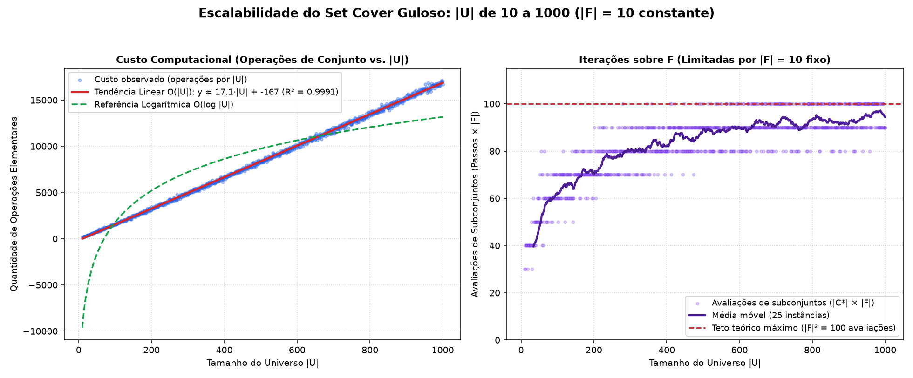

# Cobertura de Conjuntos (*Set Cover*) — Estudo Estático e Escalabilidade Dinâmica

Este repositório apresenta a implementação e a análise de escalabilidade do problema de **Cobertura de Conjuntos (*Set Cover*)**, desenvolvido para a disciplina de **Projeto e Análise de Algoritmos (PAA)**.

O projeto está dividido em duas etapas:
1. **Problema Base ([`static_problem/`](./static_problem/)):** Resolução passo a passo de uma instância fixa para ilustrar a heurística gulosa.
2. **Problema Dinâmico ([`dynamic_problem/`](./dynamic_problem/)):** Experimento de escalabilidade variando o tamanho do universo $n = |U|$ de $10$ até $1000$ (com $m = |\mathcal{F}| = 10$ constante), medindo o custo em operações elementares.

---

## 1. O Problema Base (*Set Cover*)

Dado um conjunto universo $U = \{u_1, u_2, \dots, u_n\}$ com $n = |U|$ elementos e uma família $\mathcal{F} = \{S_1, S_2, \dots, S_m\}$ de $m = |\mathcal{F}|$ subconjuntos de $U$ cuja união cobre todo o universo ($\bigcup_{S \in \mathcal{F}} S = U$), o objetivo é encontrar uma subcoleção $\mathcal{C}^* \subseteq \mathcal{F}$ de **tamanho mínimo** que cubra todos os elementos de $U$:

$$\bigcup_{S \in \mathcal{C}^*} S = U$$

Como o *Set Cover* é um problema **NP-difícil**, adotamos a **heurística gulosa**: a cada passo, escolhe-se o subconjunto $S_i \in \mathcal{F}$ que cobre a maior quantidade de elementos ainda não cobertos, até que todo o universo $U$ seja coberto.

### Exemplo Estático
Para $U = \{1, 2, 3, 4, 5, 6\}$ e $\mathcal{F} = \{S_1=\{1,2,3\},\ S_2=\{2,4\},\ S_3=\{3,4,5\},\ S_4=\{4,5,6\},\ S_5=\{1,6\}\}$:
1. **Passo 1:** Escolhe $S_1 = \{1, 2, 3\}$ (cobre $3$ elementos; restam $\{4, 5, 6\}$).
2. **Passo 2:** Escolhe $S_4 = \{4, 5, 6\}$ (cobre os $3$ restantes; restam $\emptyset$).
* **Resultado:** $\mathcal{C}^* = \{S_1, S_4\}$ ($|\mathcal{C}^*| = 2$).

---

## 2. O Problema Dinâmico (Escalabilidade de $n = 10$ a $1000$)

Para avaliar como o algoritmo guloso escala na prática à medida que a entrada $n = |U|$ cresce, reutilizamos a mesma lógica do problema base em um experimento automatizado:

1. **Geração Aleatória e Crescente de $U$:** Variamos $n = |U|$ de $10$ até $1000$ ($991$ instâncias com $U = \{1, 2, \dots, n\}$).
2. **Família $\mathcal{F}$ Fixa ($m = 10$):** Para cada universo $U$, geramos $10$ subconjuntos ($S_1, \dots, S_{10}$) garantindo cobertura viável (todo elemento de $U$ é sorteado em pelo menos um $S_i$, seguido de uma amostragem extra de $35\%$ de $U$ por subconjunto para criar sobreposições).
3. **Medição de Custo (Operações):**
   * **Operações Elementares (`element_ops`):** Contabiliza a cópia inicial do universo ($n$ operações), as consultas de interseção `S & uncovered` a cada subconjunto avaliado ($\min(|S|, |U_{\text{restante}}|) + 1$ operações) e a remoção dos elementos cobertos `uncovered -= best` ($|S_{\text{escolhido}} \cap U_{\text{restante}}|$ operações).
   * **Avaliações de Subconjuntos (`subset_evals`):** Quantidade de vezes que os subconjuntos de $\mathcal{F}$ são inspecionados (passos gulosos $\times\ 10$).

---

## 3. Resultados e Curva de Custo

O gráfico abaixo (gerado por [`dynamic_problem/dynamic_solution.py`](./dynamic_problem/dynamic_solution.py) e salvo em [`dynamic_problem/results.json`](./dynamic_problem/results.json)) mostra o comportamento do algoritmo de $n = 10$ até $n = 1000$:



### Resumo dos Dados ([`results.json`](./dynamic_problem/results.json))

| Tamanho $n = \|U\|$ | Família $m = \|\mathcal{F}\|$ | Passos Gulosos ($\|\mathcal{C}^*\|$) | Avaliações de $\mathcal{F}$ | Custo Total (Operações) |
| ---: | ---: | ---: | ---: | ---: |
| **10** | 10 | 3 | 30 | 146 |
| **50** | 10 | 6 | 60 | 753 |
| **100** | 10 | 6 | 60 | 1.566 |
| **250** | 10 | 8 | 80 | 4.076 |
| **500** | 10 | 9 | 90 | 8.378 |
| **750** | 10 | 9 | 90 | 12.372 |
| **1000** | 10 | 9 | 90 | 16.732 |

### Conclusão Prática: $O(n)$ Linear vs. $O(\log n)$ Logarítmico

* **Custo em Operações sobre Elementos é Linear — $O(n)$ (Gráfico à Esquerda):**
  O custo computacional segue a reta $\text{Custo}(n) \approx 17{,}05 \cdot n - 166{,}7$ com coeficiente de determinação **$R^2 = 0{,}9991$**. Como o tamanho dos subconjuntos cresce proporcionalmente a $n$, cada operação de interseção e remoção de conjuntos realiza trabalho proporcional a $n$, resultando em complexidade prática **$O(n)$**.
* **Número de Iterações sobre $\mathcal{F}$ Cresce como $O(\log n)$ até Saturar (Gráfico à Direita):**
  Para valores pequenos de $n$ ($10$ a $250$), a quantidade de passos necessários para cobrir $U$ sobe em formato logarítmico (de $30$ para $80$ avaliações). Porém, como $m = |\mathcal{F}| = 10$ é constante, o algoritmo nunca pode dar mais que $10$ passos ($100$ avaliações no máximo). Essa saturação do número de passos em uma constante explica por que o custo total em elementos mantém-se estritamente linear $O(n)$.

---

## 4. Como Executar

```bash
# 1. Criar ambiente virtual e instalar dependências
python -m venv .venv
.\.venv\Scripts\Activate.ps1
pip install -r requirements.txt

# 2. Executar o problema estático (base)
python static_problem/static_solution.py

# 3. Executar o experimento dinâmico (gera results.json e cost_curve.png)
python dynamic_problem/dynamic_solution.py
```
